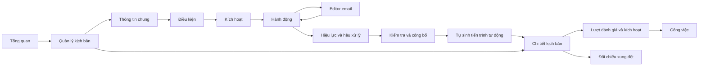

# Đặc tả sản phẩm và luồng FE

## Phạm vi và thuật ngữ

Phiên bản 0.2. Yêu cầu phản ánh cuộc hội ý; các lựa chọn chưa được người dùng chốt được đánh dấu trong sổ quyết định `07`. Mockup cần thể hiện toàn bộ vòng tạo lập, vận hành, quan sát và hậu xử lý. Mỗi nút chính phải tạo thay đổi hoặc mở nội dung có ý nghĩa.

| Thuật ngữ | Ý nghĩa trong mockup |
|---|---|
| Kịch bản | Đối tượng quản lý ổn định, có mã và nhiều phiên bản |
| Phiên bản | Một bộ cấu hình bất biến sau khi công bố |
| Tiến trình tự động | Định nghĩa vận hành sinh từ phiên bản công bố: trigger, điều kiện, hành động, hiệu lực và hậu xử lý |
| Lượt đánh giá | Một lần nhận sự kiện hoặc đến lịch, có thể kiểm tra nhiều đối tượng |
| Lượt kích hoạt | Một đối tượng thỏa điều kiện và vượt các chính sách áp dụng, bắt đầu thực hiện hành động |
| Hành động | Một yêu cầu thực hiện thuộc lượt kích hoạt; có kết quả riêng |
| Công việc hậu xử lý | Phần việc gắn với lượt kích hoạt hoặc một kỳ tổng hợp |
| Active | Kịch bản được bật, có phiên bản công bố và đang trong khoảng hiệu lực |
| Xem thử | Đánh giá dữ liệu mẫu mà không tạo lượt kích hoạt, hành động hoặc công việc |

Một lượt đánh giá theo lịch có thể tạo nhiều lượt kích hoạt. Cách đếm này là quy ước mockup D02, cần thống nhất trước hệ thống thật.

## Kiến trúc thông tin

Điều hướng chính gồm Tổng quan, Kịch bản, Công việc và Danh mục cấu hình. Tạo kịch bản là CTA xuyên suốt, không phải mục điều hướng ngang hàng. Lịch sử và xung đột được truy cập từ Kịch bản để tránh chia nhỏ quá nhiều mục.

| ID | Màn hoặc vùng chức năng | Route |
|---|---|---|
| S01 | Tổng quan | `/overview` |
| S02 | Quản lý kịch bản | `/scenarios` |
| S03 | Bước 1 Thông tin chung | `/scenarios/drafts/:draftId/basics` |
| S04 | Bước 2 Điều kiện thỏa mãn | `/scenarios/drafts/:draftId/conditions` |
| S05 | Bước 3 Cơ chế kích hoạt | `/scenarios/drafts/:draftId/trigger` |
| S06 | Bước 4 Hành động thực hiện | `/scenarios/drafts/:draftId/actions` |
| S07 | Bước 5 Hiệu lực và hậu xử lý | `/scenarios/drafts/:draftId/lifecycle` |
| S08 | Editor email | `/scenarios/drafts/:draftId/actions/:actionId/email` |
| S09 | Chi tiết kịch bản | `/scenarios/:scenarioId` với query `tab` |
| S10 | Chi tiết lượt đánh giá | `/scenarios/:scenarioId/evaluations/:evaluationId` |
| S11 | Chi tiết lượt kích hoạt | `/activations/:activationId` |
| S12 | Đối chiếu xung đột | `/conflicts/:conflictId` |
| S13 | Công việc | `/tasks` với query `taskId` để mở drawer |
| S14 | Danh mục kịch bản | `/catalogs/categories` |
| S15 | Sản phẩm dịch vụ và gói | `/catalogs/products` và `/catalogs/bundles` |
| S16 | Thư viện khả năng | `/catalogs/metrics`, `/catalogs/events`, `/catalogs/actions` |

`/` chuyển tới `/overview`. `/scenarios/new` tạo draft rỗng rồi chuyển tới basics; refresh không tạo thêm draft. Route cụ thể phải ưu tiên trước route có `:scenarioId`. ID không tồn tại có trang thông báo và đường quay lại. Bộ lọc và tab ghi vào URL; nút Back khôi phục ngữ cảnh.

## Hành vi chung

- Dữ liệu có nhãn Minh họa. Đồng hồ demo cố định; ngày, số và tiền hiển thị theo vi-VN, múi giờ Asia/Ho_Chi_Minh.
- Lưu nháp giữ cả dữ liệu chưa hợp lệ. Nút Tiếp tục kiểm tra màn hiện tại. Click một bước trước đó luôn được phép; bước sau chỉ mở khi các bước trước hợp lệ.
- Thanh cuối wizard có Quay lại, Lưu nháp, Tiếp tục. Bước cuối thay Tiếp tục bằng Xem lại và công bố. Review là drawer trên bước 5, không tạo bước 6.
- Tự lưu sau 600 ms ngừng sửa; hiển thị Đang lưu, Đã lưu lúc và lỗi lưu. Nếu lỗi quota, giữ draft trong bộ nhớ, hiện cảnh báo chưa lưu và cho tải JSON bản nháp; không báo đã lưu giả.
- Rời editor hoặc wizard khi còn thay đổi chưa lưu phải có lựa chọn lưu, bỏ thay đổi hoặc ở lại. Cancel editor phục hồi nội dung lúc mở.
- Loading, không có dữ liệu, không tìm thấy kết quả, lỗi, không có quyền và dữ liệu thiếu đều có thông điệp và thao tác tiếp theo.
- Chi tiết kỹ thuật như payload, schema, biểu thức JSON nằm trong vùng kỹ thuật thu gọn, không xuất hiện mặc định ở flow nghiệp vụ.

## S01 Tổng quan

Đầu trang có tiêu đề Tổng quan, mốc dữ liệu, khoảng thống kê và CTA Tạo kịch bản. Phần danh mục nằm trong viewport đầu: mỗi danh mục có tổng kịch bản, số active, tên và mô tả ngắn. Danh mục rỗng vẫn có điểm vào.

Chỉ số vận hành: lượt kích hoạt trong kỳ, khách hàng duy nhất trong kỳ, hành động thất bại chưa xử lý và công việc quá hạn. Một biểu đồ xu hướng lượt kích hoạt theo ngày có tooltip và bảng dữ liệu thay thế. Tất cả chỉ số được tính từ store, không hardcode độc lập.

Vùng Cần chú ý ưu tiên xung đột chưa rà soát, hành động lỗi, công việc quá hạn và kịch bản sắp hết hiệu lực. Bấm danh mục mở S02 với bộ lọc; bấm số active thêm trạng thái; bấm lỗi/công việc mở đúng danh sách chi tiết. Không có cảnh báo thì hiển thị trạng thái đã xử lý hết.

Số tổng và active phản ánh danh mục hiện tại tại đồng hồ demo. Bộ chọn kỳ chỉ tác động chỉ số và biểu đồ hoạt động; nhãn phải thể hiện khác biệt này. Tổng mặc định loại kịch bản đã xóa quản trị, lịch sử riêng vẫn giữ.

## S02 Quản lý kịch bản

Bảng mặc định: mã và tên; danh mục; loại kích hoạt; hiệu lực; trạng thái; người phụ trách; lượt kích hoạt trong kỳ; cảnh báo; menu thao tác. Cho bật thêm nhãn, loại hành động và kênh. Tên cố định bên trái khi cuộn ngang. Phân trang 12 dòng; sắp xếp tên, cập nhật gần nhất hoặc lượt kích hoạt.

Tìm kiếm tên/mã không phân biệt dấu tiếng Việt. Bộ lọc gồm category, nhãn, nhóm sản phẩm, người, đơn vị, trạng thái, khoảng hiệu lực giao nhau, loại kích hoạt, loại hành động, kênh và xung đột. Giá trị trong cùng facet kết hợp OR; khác facet kết hợp AND. Bộ lọc hiện thành chip xóa được và có Xóa tất cả. Lưu bộ lọc theo persona demo.

Click tên mở S09. Menu có Sửa, Nhân bản, Tạm dừng/Tiếp tục, Kết thúc theo quyền. Nhân bản tạo draft với ID mới và không mang theo lịch sử. Người thường không có nút Xóa. Admin có Xóa quản trị với lý do bắt buộc, xác nhận đúng mã và nhật ký. Mockup dùng tombstone giữ dữ liệu lịch sử; không xây xóa dây chuyền.

## S03 Thông tin chung

| Trường | Bắt buộc | Quy tắc |
|---|---|---|
| Mã | Tự sinh | `SMS-0001` tăng theo store, duy nhất, không sửa |
| Tên | Có | Trim, 5 đến 120 ký tự; trùng tên cảnh báo nhưng mã vẫn riêng |
| Danh mục | Có | Một danh mục chính đang sử dụng |
| Mục đích | Có | 20 đến 800 ký tự để người khác hiểu ý định |
| Đơn vị phụ trách | Có | Chọn từ danh sách đơn vị mẫu |
| Người phụ trách | Có | Thành viên thuộc đơn vị, mặc định người tạo nếu phù hợp |
| Nhãn | Không | Nhiều nhãn; tối đa 8 theo quy ước mockup |

Không đặt cấu hình thời gian hay quyền thực thi ở màn này. Sidebar tóm tắt tên, danh mục và tiến độ hoàn tất. Danh mục ngừng sử dụng vẫn hiển thị trên phiên bản cũ, không xuất hiện trong lựa chọn mới.

## S04 Điều kiện thỏa mãn

Ba vùng ở desktop: thư viện đại lượng 260 px, vùng xây công thức co giãn, panel diễn giải/xem thử 320 px. Cấp đối tượng nằm đầu vùng công thức, mặc định Khách hàng. Mockup cho chọn Khách hàng hoặc Tài khoản; dữ liệu cấp khoản đầu tư là khả năng mở rộng chưa bật và có giải thích.

Thư viện chia nhóm tài sản cổ phiếu, phái sinh, nợ, trái phiếu, CCQ, MM, hồ sơ và hành vi. Một đại lượng có tên, đơn vị, cấp đối tượng, mô tả và mốc dữ liệu. Người dùng thêm bằng click; mode nâng cao hỗ trợ kéo thả vào vị trí chèn trong công thức.

Một điều kiện gồm vế trái, toán tử, vế phải. Vế trái/phải có thể là đại lượng, hằng số hoặc phép tính. Loại số có >, >=, <, <=, =, != và trong khoảng; ngày có trước/sau/trong khoảng và số ngày kể từ; danh sách có thuộc/không thuộc; boolean có đúng/sai; mọi loại có đã có/chưa có dữ liệu. Phép tính hỗ trợ +, -, ×, ÷ với kiểm tra đơn vị.

Mode cơ bản dùng nhóm Tất cả/Ít nhất một, cho thêm nhóm lồng nhau, xóa hoặc nhân bản nhánh. Mode nâng cao biểu diễn mỗi điều kiện bằng một khối thu gọn, bấm để sửa trong cửa sổ phụ; cho chèn VÀ, HOẶC, dấu mở/đóng ngoặc tại vị trí chọn và kéo đổi vị trí. Ngoặc được tính trước, sau đó VÀ, rồi HOẶC. Hai mode dùng cùng cây điều kiện, chuyển qua lại giữ nguyên logic và không còn giới hạn ba cấp nhóm.

Công thức thiếu điều kiện, thiếu/thừa ngoặc hoặc thiếu toán tử được đánh dấu tại vị trí lỗi. Bản nháp giữ cả công thức đang ghép dở qua tải lại trang; không cho xem thử, chuyển về cơ bản hoặc đi tiếp bằng kết quả cũ khi công thức chưa hợp lệ. Có thể khôi phục công thức hợp lệ gần nhất. Nhóm rỗng không hợp lệ. Kiểm tra chi tiết về kiểu, đơn vị, chia không và dữ liệu thiếu theo `05`.

Đại lượng dạng số hỗ trợ loại điều kiện Biến động tăng/giảm trong cả hai mode. Người dùng chọn chiều Tăng/Giảm, cách đo theo phần trăm hoặc số tuyệt đối, mốc so sánh (lần cập nhật trước, 1/7/30 ngày trước), phép so sánh và ngưỡng không âm. Khối thu gọn hiển thị cả chiều, ngưỡng và mốc so sánh. Chỉ thỏa khi giá trị thực sự chuyển động theo chiều đã chọn.

Panel phải diễn giải tự động từ cây điều kiện, không nhập mô tả thứ hai. Nút Xem thử trả tổng đối tượng, thỏa, không thỏa và thiếu dữ liệu. Bấm một khách mở drawer giải thích từng nhánh bằng giá trị mẫu và thời điểm. Chỉ số đổi sau khi chạy lại; thay công thức đánh dấu Kết quả cần cập nhật. Không bịa số khách để trang đẹp.

S04 chưa có ngữ cảnh sự kiện: chỉ cho dùng đại lượng khách/tài khoản. Các ràng buộc trên payload sự kiện được cấu hình ở S05, tránh công thức bước 2 phụ thuộc lựa chọn chưa có.

## S05 Cơ chế kích hoạt

Hai tab là hai lựa chọn loại trừ: Theo sự kiện và Theo thời gian. Draft giữ cấu hình tạm của cả hai để đổi tab không mất dữ liệu; phiên bản công bố chỉ mang một nhánh đang chọn.

Theo sự kiện: tìm và chọn trong nhóm Onboard, Tiền, Giao dịch, Quyền và cổ tức, Lưu ký, Vay nợ, Trái phiếu, CCQ, MM. Mockup cho chọn nhiều sự kiện theo nghĩa Bất kỳ sự kiện đã chọn, không hỗ trợ chuỗi sự kiện. Mỗi event hiển thị ý nghĩa, cấp đối tượng và payload được dùng để lọc thêm. Sự kiện phải xác định được khách hàng/tài khoản liên quan; không lấy một sự kiện cá nhân để quét toàn bộ khách hàng.

Theo thời gian: chọn mỗi N giờ/ngày/tuần/tháng/năm, giờ chạy, thứ trong tuần hoặc ngày trong tháng tùy loại. Chọn lịch mọi ngày, ngày làm việc hoặc ngày giao dịch, cộng ngày nghỉ và khoảng nghỉ riêng. Hiển thị 5 thời điểm tiếp theo trong khoảng hiệu lực. Draft khởi tạo hiệu lực tạm từ demoNow và chưa có ngày kết thúc; ở bước 3 ghi Hiệu lực sẽ xác nhận tại bước 5, sau khi xác nhận phải tính lại lịch. Múi giờ luôn hiện; lịch giao dịch trong mockup ghi Lịch minh họa, chưa kết nối lịch sở giao dịch.

Ngày 31 ở tháng ngắn mặc định bỏ lần đó; ngày nghỉ mặc định bỏ lần đó, không tự dồn sang ngày tiếp theo. Lựa chọn khác để vòng sau. Chu kỳ và giờ cụ thể không được tạo lịch mâu thuẫn; bật từng loại trường theo recurrence schema trong `05`.

Khối Tái kích hoạt dùng chung: mỗi sự kiện/lượt lịch hợp lệ, một lần trong vòng đời, sau khoảng nghỉ, hoặc khi thoát điều kiện rồi thỏa trở lại. Dữ liệu thiếu không chứng minh đã thoát điều kiện. Hiển thị bản diễn giải cuối: khi nào xét, xét ai và khi nào được thực hiện lại.

## S06 Hành động thực hiện

Danh sách action có thêm, sửa, đổi thứ tự và xóa khỏi draft. Ít nhất một action hợp lệ để đi tiếp. Quy ước mockup thực hiện tuần tự theo thứ tự; một action lỗi được ghi nhận rồi tiếp tục action sau. Phụ thuộc giữa action và nhánh bù trừ ngoài phạm vi. Nêu rõ quy ước này trong phần nâng cao.

Thông báo gồm người nhận (KH, tư vấn đầu tư, DVKH, quản lý), resolver người nhận, nhiều kênh email/noti/SMS, mức ưu tiên và nội dung riêng từng kênh. Noti có tiêu đề, body, liên kết. SMS có body và bộ đếm ký tự; không khẳng định số segment/chi phí nhà mạng. Email có subject, preheader, nội dung và CTA. Chọn kênh nào phải điền nội dung kênh đó.

Chèn biến từ danh sách hợp lệ với token, mô tả và ví dụ. Preview chọn một khách mẫu để xem bản đã thay biến. Biến không có nguồn hoặc thiếu giá trị bắt buộc làm preview báo lỗi; không âm thầm gửi chuỗi token. Nội dung và snapshot đã render được lưu trong lịch sử mô phỏng.

Giao việc cấu hình người/nhóm, tiêu đề, nội dung, thời hạn và kết quả bắt buộc khi đóng. Offer cho chọn nhiều sản phẩm hoặc một bundle, chọn vị trí giả lập trên ứng dụng giao dịch, nội dung, CTA và hiệu lực offer không vượt hiệu lực kịch bản. Sản phẩm hết/ngừng hiệu lực được chỉ rõ, không cho pick mới.

Kiểm soát nghiệp vụ có khóa tài khoản, khóa phát vay, khóa rút tiền, khóa giao dịch; chọn đúng phạm vi và lý do. Chỉ manager/admin demo có quyền cấu hình/công bố. Khi mô phỏng, action chỉ ghi nhật ký Không tác động hệ thống thật; không sửa trạng thái tài khoản mẫu để tạo cảm giác thao tác thật đã được thực hiện.

## S08 Editor email

Editor là trang riêng có breadcrumb quay về action, subject/preheader, thanh định dạng, vùng soạn và preview desktop/mobile. Dùng rich text với đoạn, heading, đậm/nghiêng, danh sách, link, biến và nút CTA. Cho chọn ba bố cục có sẵn: thông tin, mời trao đổi, offer. Không hứa hỗ trợ thiết kế email HTML tùy ý hoặc gửi tương thích mọi mail client.

Lưu và quay lại cập nhật đúng actionId và draftId. Nút Hủy phục hồi bản trước khi mở. Preview dùng dữ liệu mẫu; đổi khách mẫu không sửa body. Nội dung được lưu JSON có cấu trúc, render HTML đã lọc, không thực thi script hoặc HTML tự do.

## S07 Hiệu lực và hậu xử lý

Hiệu lực yêu cầu thời điểm bắt đầu; kết thúc tùy chọn và phải sau bắt đầu. Khoảng hiệu lực dùng start bao gồm, end không bao gồm. Thay hiệu lực làm mất hiệu lực kết quả kiểm tra lịch trước đó.

Hậu xử lý từng lần và theo kỳ là hai công tắc độc lập. Từng lần chọn lúc đã kích hoạt hoặc lúc action kết thúc, điều kiện kết quả, phần việc, người/nhóm nhận, thời hạn. Theo kỳ chọn cửa sổ dữ liệu, lịch chạy, bộ lọc trạng thái, chỉ số và người xử lý. Tập bản ghi đóng băng khi tạo batch để mở lại vẫn thấy cùng cơ sở.

Mockup theo kỳ hỗ trợ ngày trước, tuần trước, tháng trước và khoảng ngày tùy chọn; tuần bắt đầu thứ Hai. Lọc tất cả/chưa xử lý/action thất bại. Mỗi cửa sổ và bộ quy tắc chỉ tạo một batch; chạy lại mở batch đã có. Batch đánh dấu đã rà soát riêng với task từng khách, không tự hoàn tất các việc thành viên.

Review drawer gom năm bước, các lỗi có link về đúng trường, cảnh báo xung đột và kết quả xem thử gần nhất. Editor có thể lưu nháp; manager/admin có Công bố. Quy trình nhiều cấp duyệt là vấn đề cần chốt, mockup không tự thêm màn duyệt.

Sau khi kiểm tra hợp lệ, Công bố tự sinh tiến trình và đăng ký nguồn kích hoạt trong cùng một thao tác. Thành công hiển thị “Tiến trình tự động đã được tạo”, mã tiến trình, phiên bản, cơ chế kích hoạt và trạng thái chờ hiệu lực/đang hoạt động. Có CTA Xem tiến trình để mở S09. Không yêu cầu người dùng tạo job hoặc nhờ CNTT cấu hình thêm. Nếu tạo/ghi tiến trình thất bại, giữ nháp và phiên bản đang chạy; không công bố một phần. Chi tiết flow ở `08`.

## S09 Chi tiết kịch bản

Header có mã, tên, danh mục, phiên bản công bố, badge Có bản sửa nháp, trạng thái và CTA theo quyền. Tabs: Tổng quan, Cấu hình, Tiến trình tự động, Lịch sử thực hiện, Hậu xử lý, Phiên bản. Mốc thống kê hiện rõ.

Tab Tổng quan cho biết hiệu lực, cơ chế, công thức diễn giải, nhóm action, chỉ số và việc cần chú ý. Cấu hình chỉ đọc có link Sửa để clone published thành draft. Phiên bản cho đối chiếu các trường đã thay đổi, tác giả, lý do công bố và thời điểm; không cho sửa lịch sử.

Tab Tiến trình tự động hiển thị mã, phiên bản, trạng thái, nguồn sự kiện hoặc 5 mốc lịch tiếp theo và sơ đồ chỉ đọc sinh từ AutomationPlan. Node điều kiện/hành động/hậu xử lý mở panel cấu hình tương ứng. Có hai nhánh hậu xử lý khi cả hai được bật. Thay cấu hình rồi công bố phải tạo sơ đồ tương ứng phiên bản mới. Kịch bản còn nháp chưa có tiến trình; không vẽ trạng thái đang chạy giả.

Tạm dừng ngăn lượt mới; các hành động/công việc đang có tiếp tục theo quy ước mockup. Kết thúc đóng hiệu lực cho lượt mới và là thao tác không bật lại; nhân bản nếu muốn tạo kịch bản mới. Phiên bản mới chỉ áp dụng lượt đánh giá mới; lượt cũ giữ phiên bản cũ.

## S10 và S11 Lịch sử

S10 cho xem nguồn trigger, phiên bản, thời điểm, tổng đối tượng, thỏa/không thỏa/thiếu dữ liệu/bị chính sách loại. Danh sách đối tượng có lý do và link tới S11 nếu thực sự kích hoạt. Tổng các nhóm phải đối soát với số đối tượng đã xét.

S11 hiển thị khách hàng/tài khoản, trigger, snapshot dữ liệu, cây đánh giá có kết quả từng nhánh, danh sách action, nội dung đã render, các attempt và task. Dòng thời gian dùng các mốc có dữ liệu, không có chấm hoạt động trang trí. Có thử lại action lỗi mô phỏng, nhưng attempt cùng actionRun không làm tăng lượt kích hoạt hay tạo lại task.

Một modal Chạy mô phỏng trong S09 cho chọn event hoặc mốc lịch cùng dữ liệu mẫu để tạo lịch sử tương tác. S04 chỉ xem thử, không dùng chung nút hoặc tác dụng với modal này.

## S12 Xung đột

Mở từ badge ở S02/S09 hoặc vùng Cần chú ý. Màn đối chiếu hai kịch bản có tên, phiên bản, hiệu lực, tệp mẫu giao nhau và hành động/nội dung liên quan. Hiển thị rõ kết quả theo quy tắc, chồng lấn quan sát trên dữ liệu mẫu hoặc nghi vấn cần rà soát.

Mockup phát hiện giao nhau của lịch hiệu lực và đối tượng mẫu, kết hợp ma trận action trong `05`. Nghi vấn ngữ nghĩa có fixture gắn nhãn Minh họa rà soát, không quảng cáo AI tự hiểu mọi nội dung. Không tìm thấy mẫu giao nhau phải ghi Chưa phát hiện trên tập mẫu, không kết luận chắc chắn không xung đột.

Người dùng chọn mở sửa, tạm dừng kịch bản theo quyền, hoặc ghi nhận Chấp nhận cùng tồn tại/Không phải xung đột kèm lý do. Kết luận gắn với cặp phiên bản; sửa một bên làm kết luận cũ cần rà soát lại. Rà soát không tự động chỉnh cấu hình.

## S13 Công việc

Hai tab Từng lần và Theo kỳ, các view Việc của tôi/Của đơn vị/Tất cả theo quyền. Bảng có nguồn kịch bản, khách hàng hoặc kỳ dữ liệu, loại việc, người nhận, hạn, trạng thái. Trạng thái gồm Mới, Đang xử lý, Hoàn tất, Hủy; Quá hạn là thuộc tính tính từ hạn và trạng thái.

Drawer cho nhận việc, đổi người nếu có quyền, cập nhật ghi chú, hoàn tất với kết quả bắt buộc. Batch mở danh sách thành viên và số liệu tại thời điểm tổng hợp. Thay trạng thái task cập nhật ngay dashboard và chi tiết kịch bản. Ghi chú có tác giả/thời điểm và không thể sửa đè lịch sử bằng đổi người nhận.

## S14 đến S16 Danh mục và cấu hình

Category có mã, tên, mô tả, trạng thái. Product/service có mã, tên, nhóm, mô tả, hiệu lực, trạng thái. Bundle có mã, tên và các productId. Mockup có tạo/sửa/ngừng sử dụng; trùng mã báo lỗi. Bundle hiển thị sản phẩm hết hiệu lực và bị chặn khi chọn offer mới.

Thư viện metric/event/action đọc được định nghĩa, cấp đối tượng, kiểu, đơn vị, dữ liệu mẫu và trạng thái. Mockup chỉ cho sửa tên/mô tả/trạng thái thư viện bằng admin; thêm khả năng tính toán hoặc kết nối mới cần dev, không giả vờ chỉ khai báo tên là chạy được. Đây là giới hạn cần thể hiện trong màn quản trị.

## Quyền và trạng thái

Quy ước mockup: Viewer xem; Editor tạo/sửa draft và nhận việc được giao; Manager công bố, tạm dừng, kết thúc, phân công trong đơn vị và cấu hình kiểm soát nghiệp vụ; Admin có thêm danh mục/quyền xóa quản trị. UI có persona selector trong công cụ demo; không gọi đây là xác thực production.

Trạng thái hiển thị: Nháp, Chờ hiệu lực, Đang hoạt động, Tạm dừng, Hết hiệu lực, Đã kết thúc, Đã xóa quản trị. Draft sửa tồn tại song song phiên bản công bố nên không làm kịch bản đang chạy biến thành Nháp. Action lỗi là cảnh báo vận hành riêng, không tự đổi lifecycle thành Lỗi.

## Ngoài phạm vi lượt mockup

Không phát triển backend production, kết nối core, gửi tin thật, giao dịch thật, scheduler nền khi trình duyệt đóng, AI phát hiện mâu thuẫn ngữ nghĩa, engine lịch sở giao dịch đầy đủ, phân quyền server hoặc xử lý dữ liệu khách hàng thật. Các ranh giới này nằm trong phần giới thiệu demo và công cụ trình diễn; không biến flow nghiệp vụ thành trang cảnh báo kỹ thuật.
