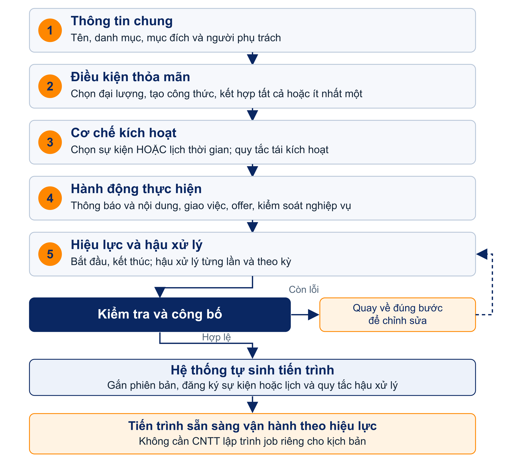
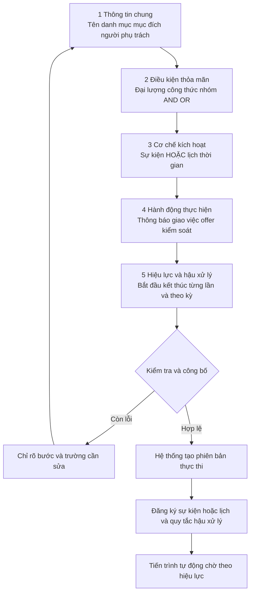
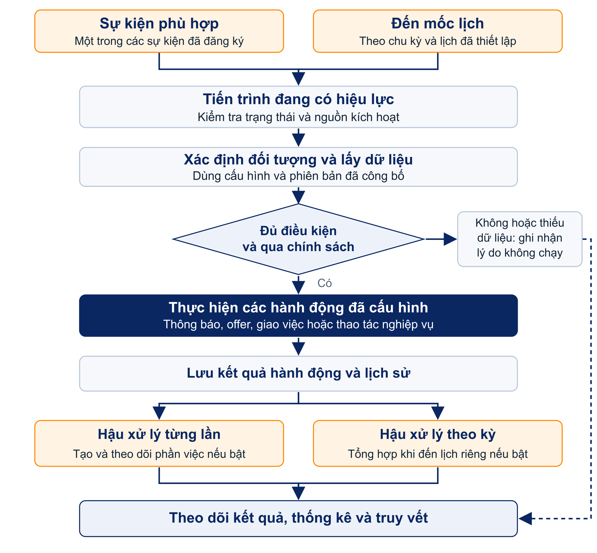
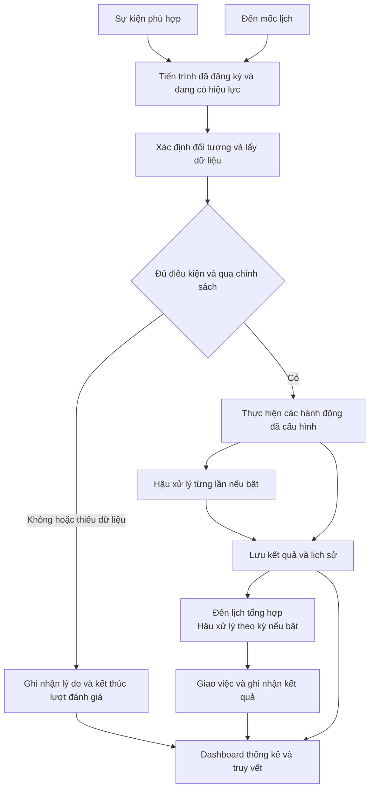

# Luồng tạo kịch bản và tự động hóa

## Kết quả nghiệp vụ cần đạt

Khi người dùng hoàn tất cấu hình và công bố, SMS tự sinh một tiến trình tự động mang đúng thiết lập để vận hành. Không có bước bàn giao từng kịch bản cho CNTT viết job, cron hoặc trigger riêng. CNTT xây khả năng dùng chung và tích hợp; nghiệp vụ tự tạo, sửa, công bố và quản lý các kịch bản dựa trên những khả năng đã có.

Lưu nháp chỉ giữ cấu hình chưa công bố. Công bố hợp lệ tạo phiên bản thực thi và đăng ký tiến trình. Đến ngày hiệu lực, tiến trình bắt đầu chờ sự kiện hoặc lịch. Hành động chỉ được thực hiện khi có kích hoạt phù hợp và đối tượng đủ điều kiện.

## Sơ đồ thiết lập

Mũi tên quay lại bước 1 biểu diễn quay lại wizard; lỗi cụ thể phải dẫn về đúng bước có trường sai, không bắt đi lại từ đầu. Editor email là nhánh phụ của bước 4 và quay lại đúng action. Hai chế độ hậu xử lý ở bước 5 có thể bật đồng thời.

## Sơ đồ vận hành

Hậu xử lý theo kỳ là nhánh độc lập lấy các bản ghi trong cửa sổ dữ liệu; không yêu cầu từng task của mọi khách phải hoàn tất trước mới được tổng hợp. Các lượt tiếp theo tiếp tục theo event/lịch và quy tắc tái kích hoạt cho tới khi tạm dừng, hết hiệu lực hoặc kết thúc.

## Hệ thống sinh những gì khi công bố

| Đầu ra | Nội dung |
|---|---|
| Phiên bản cấu hình | Snapshot thông tin chung, điều kiện, trigger, action, hiệu lực và hậu xử lý |
| Định nghĩa tiến trình | Các bước thực thi cùng tham số, tham chiếu phiên bản và mã tiến trình |
| Đăng ký kích hoạt | Event subscription hoặc lịch cùng lịch nghỉ và quy tắc tái kích hoạt |
| Quy tắc hậu xử lý | Cách tạo task từng lần và cách tổng hợp theo kỳ |
| Trạng thái vận hành | Chờ hiệu lực, đang chờ kích hoạt, tạm dừng, hết hiệu lực hoặc đã kết thúc |

Các đầu ra được tạo trong một thao tác công bố thống nhất. Nếu cấu hình không hợp lệ hoặc không sinh được tiến trình, không công bố nửa chừng. Bản đang hoạt động trước đó tiếp tục nguyên vẹn, người dùng nhận lỗi tại draft.

## Thể hiện trong mockup

Sau Công bố, hiển thị kết quả Tiến trình tự động đã được tạo, mã tiến trình, phiên bản và nguồn kích hoạt. Trong chi tiết kịch bản có tab Tiến trình tự động thể hiện sơ đồ chỉ đọc, tham số đã gắn, trạng thái và mốc lịch tiếp theo hoặc event đang lắng nghe.

Plan được sinh từ config thật trong store, không là một hình minh họa cố định. Sửa loại trigger/action rồi công bố phải làm sơ đồ và tham số đổi tương ứng. Hành động bên ngoài được mô phỏng; giao diện không khẳng định đã triển khai job production hoặc đang chạy nền khi browser đóng.

## Mã nguồn sơ đồ

Ảnh PNG dùng trong Word được render từ hai SVG cùng tên trong `figures`. Nội dung tương ứng được giữ dưới dạng Mermaid ở trên để chỉnh sửa và trao đổi. Khi flow thay đổi, cập nhật cả nội dung, hình và tiêu chí kiểm tra.
