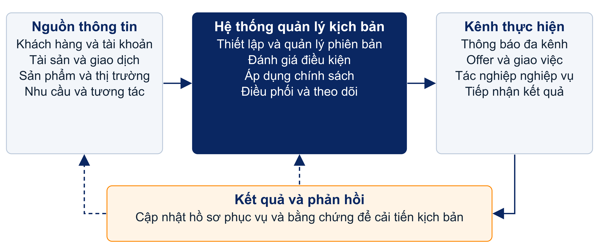
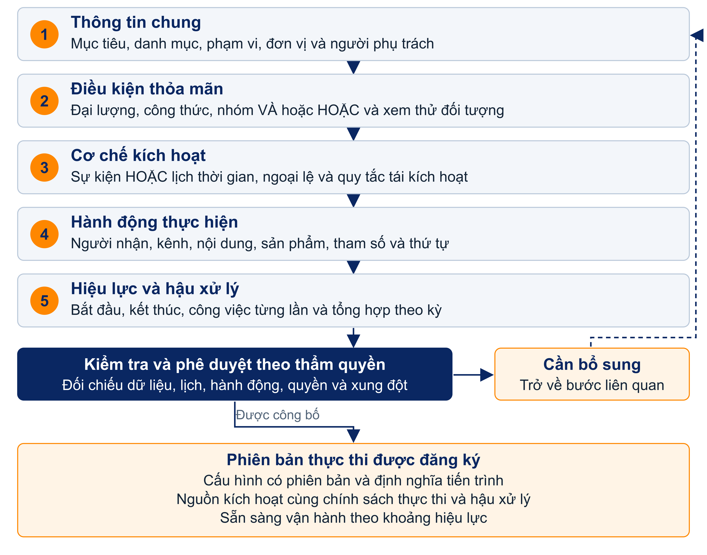
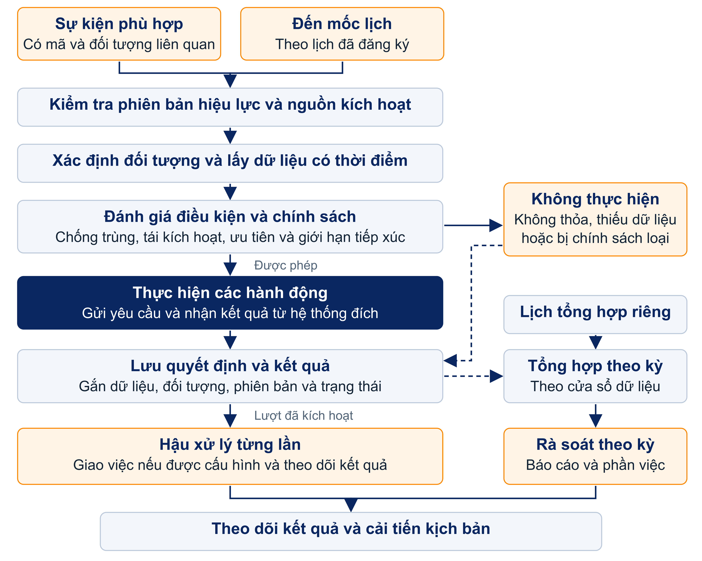

# Phương án triển khai hệ thống quản lý kịch bản

Scenario Management System

## Định hướng đề xuất

Đề xuất xây dựng hệ thống quản lý kịch bản như một năng lực điều phối tương tác và quy trình nghiệp vụ của SHS. Hệ thống kết nối thông tin khách hàng, tài sản, hành vi và sự kiện với các hành động phục vụ cụ thể, từ thông báo, giới thiệu giải pháp đến giao việc và theo dõi kết quả xử lý.

Khi danh mục sản phẩm mở rộng sang nhiều lớp tài sản, chất lượng phục vụ phụ thuộc vào khả năng hiểu hoàn cảnh của từng khách hàng và duy trì sự phối hợp giữa các bộ phận. Một nền tảng kịch bản thống nhất giúp các đơn vị xác định tình huống cần quan tâm, lựa chọn thời điểm tác động, kiểm soát cách thực hiện và tích lũy thông tin cho những lần phục vụ tiếp theo.

Phương án tổ chức hệ thống theo các thành phần dùng chung: dữ liệu và đại lượng, điều kiện, sự kiện hoặc lịch, hành động, chính sách vận hành và hậu xử lý. Kịch bản được cấu hình, kiểm tra, phê duyệt theo thẩm quyền rồi công bố thành phiên bản thực thi. Nền tảng điều phối các phiên bản này và ghi nhận toàn bộ quá trình ra quyết định.

Tài liệu trình bày ý tưởng, nguyên tắc thiết kế, phương pháp xây dựng kịch bản, luồng vận hành và cách tổ chức triển khai. Cơ sở để khởi động chương trình là thống nhất chủ sở hữu nghiệp vụ, phạm vi ưu tiên, nguồn dữ liệu và tiêu chí đánh giá kết quả.

### Nội dung thuyết minh

Định vị và mô hình năng lực · Nguyên tắc thiết kế · Phương pháp xây dựng kịch bản · Nền tảng dữ liệu · Luồng thiết lập và vận hành · Quản trị · Ứng dụng · Lộ trình triển khai · Đo lường và tổ chức thực hiện.

<!-- page -->

## 1 Định vị hệ thống trong định hướng quản lý tài sản

SHS đang mở rộng nền sản phẩm từ chứng khoán cơ sở, phái sinh, cho vay ký quỹ và ứng trước sang trái phiếu, chứng chỉ quỹ, money market cùng các dịch vụ đầu tư khác. Sự mở rộng này tạo nhu cầu theo dõi khách hàng trên nhiều lớp tài sản, gắn thông tin giao dịch với mục tiêu, nhu cầu thanh khoản và lịch sử tương tác.

Hệ thống quản lý kịch bản đảm nhiệm việc nhận biết tình huống và điều phối phản ứng. Các hệ thống nguồn tiếp tục quản lý giao dịch, số dư, hồ sơ và sản phẩm. Kết quả xử lý được trả về để cập nhật công việc, lịch sử phục vụ và báo cáo điều hành.

### Ba lớp trách nhiệm

**Lớp thông tin** cung cấp dữ liệu có định danh, thời điểm và chất lượng rõ ràng. **Lớp quyết định** xác định đối tượng, kiểm tra điều kiện và áp dụng chính sách. **Lớp thực hiện** chuyển quyết định thành thông báo, đề nghị tương tác, công việc hoặc yêu cầu nghiệp vụ, đồng thời trả lại kết quả.

Phạm vi thiết kế bao gồm cả khách hàng và tài khoản. Với từng đại lượng, hệ thống phải chỉ rõ phạm vi tính toán để tránh cộng trùng tài sản, trộn số dư của các tài khoản hoặc áp dụng dữ liệu của một sản phẩm cho toàn bộ quan hệ khách hàng.

Vai trò của nền tảng trong định hướng quản lý tài sản là nâng khả năng phục vụ có ngữ cảnh. Mức độ cá nhân hóa được mở rộng theo chất lượng hồ sơ, phạm vi sản phẩm và các dịch vụ thực tế mà công ty triển khai.

<!-- page -->

## 2 Nguyên tắc thiết kế

### Lấy tình huống khách hàng làm điểm xuất phát

Kịch bản bắt đầu từ một nhu cầu hoặc vấn đề cần xử lý, có mục tiêu và người chịu trách nhiệm. Dữ liệu về tài sản, giao dịch và hồ sơ được sử dụng để nhận diện tình huống đó. Hành động phải phù hợp với mục tiêu phục vụ và bối cảnh tại thời điểm thực hiện.

### Tách rõ điều kiện và thời điểm đánh giá

Điều kiện trả lời đối tượng nào phù hợp; sự kiện hoặc lịch trả lời khi nào cần đánh giá. Hiệu lực quy định khoảng thời gian kịch bản được phép vận hành. Cách tách này giúp dùng lại một công thức cho nhiều mục đích và giải thích chính xác vì sao một lượt đã được thực hiện.

### Chuẩn hóa thành phần để mở rộng nhất quán

Đại lượng, sự kiện, hành động và sản phẩm được quản lý trong thư viện dùng chung. Mỗi thành phần có định nghĩa, đầu vào, giới hạn sử dụng và đơn vị quản lý. Việc bổ sung nguồn dữ liệu hoặc khả năng thực hiện mới làm tăng phạm vi cấu hình của cả nền tảng.

### Kết quả phải giải thích và truy vết được

Một lượt xử lý cần lưu được phiên bản kịch bản, nguồn kích hoạt, dữ liệu đã dùng, kết quả điều kiện, chính sách áp dụng và trạng thái từng hành động. Dữ liệu thiếu hoặc quá cũ phải được nhận diện riêng. Trạng thái của hệ thống đích là căn cứ ghi nhận kết quả thực hiện.

### Kiểm soát trên toàn bộ quan hệ khách hàng

Hạn mức tiếp xúc, thứ tự ưu tiên, chống trùng và xử lý xung đột được áp dụng xuyên kịch bản. Các chính sách phân biệt mục đích thông báo, kênh liên hệ và mức độ ảnh hưởng của hành động. Hệ thống cần hỗ trợ dừng, hoãn hoặc chuyển xử lý thủ công khi chưa đủ điều kiện thực hiện.

### Thay đổi có phiên bản và phạm vi hiệu lực

Mỗi lần công bố tạo một phiên bản xác định. Bản sửa được kiểm tra trước khi thay thế bản hiện hành; lịch sử đã phát sinh giữ nguyên tham chiếu phiên bản cũ. Chính sách chuyển tiếp phải quy định rõ cách xử lý các lượt đang chờ, yêu cầu đang gửi và công việc đã giao.

### Khép kín vòng phản hồi

Kết quả thực thi được nối với kết quả phục vụ khách hàng. Thông tin từ cán bộ phụ trách và kênh tương tác trở thành đầu vào cho lần đánh giá tiếp theo, đồng thời giúp điều chỉnh điều kiện, nội dung, thời điểm và nguồn lực xử lý.

<!-- page -->

## 3 Phương pháp xây dựng và cải tiến kịch bản

Phương pháp đề xuất đi từ mục tiêu nghiệp vụ đến bằng chứng dữ liệu, sau đó xác định cách thực hiện và cách đo kết quả. Mỗi kịch bản cần có một hồ sơ thiết kế để người xây dựng, người phê duyệt và người vận hành hiểu cùng một logic.

### Xác định tình huống và kết quả mong muốn

Mô tả điều gì đang xảy ra, vì sao cần tác động và kết quả nào được xem là hoàn tất. Mục tiêu cần quan sát được, chẳng hạn hoàn thiện một thông tin còn thiếu, xác nhận một nhu cầu hoặc xử lý xong một phần việc. Mỗi kịch bản có một chủ sở hữu và một kỳ xem xét hiệu quả.

### Xác định đối tượng và bằng chứng

Chọn cấp khách hàng hoặc tài khoản, phạm vi sản phẩm và dữ liệu cần dùng. Mỗi điều kiện phải liên hệ với tình huống đã nêu. Đối với các dấu hiệu chỉ mang tính suy đoán, hành động phù hợp có thể là đề nghị cán bộ xác minh nhu cầu trước khi thực hiện bước tiếp theo.

### Chọn thời điểm và thiết kế phản ứng

Xác định sự kiện hoặc lịch đánh giá, hiệu lực, ngoại lệ và quy tắc tái kích hoạt. Lựa chọn hành động, nội dung, người nhận, thứ tự thực hiện và điều kiện dừng. Phần việc hậu xử lý phải có đơn vị tiếp nhận, thời hạn và cách ghi nhận kết quả.

### Kiểm chứng trước khi công bố

Đánh giá cấu hình trên tập dữ liệu có thời điểm xác định hoặc dữ liệu lịch sử phù hợp. Kiểm tra các trường hợp thỏa, không thỏa, thiếu dữ liệu, sự kiện trùng và hành động lỗi. Ước lượng quy mô khách hàng chịu tác động và khối lượng công việc phát sinh; đối chiếu với năng lực tiếp nhận của kênh và nhân sự.

### Đo kết quả và điều chỉnh có căn cứ

Sau khi vận hành, đối chiếu kết quả thực tế với mục tiêu và đường cơ sở đã chọn. Các chỉ số hoạt động giúp tìm điểm nghẽn; kết quả nghiệp vụ cho biết giá trị của kịch bản. Khi điều kiện cho phép, sử dụng nhóm so sánh phù hợp để giảm việc quy toàn bộ biến động kết quả cho tác động của kịch bản.

**Hồ sơ tối thiểu** gồm mục tiêu, chủ sở hữu, phạm vi đối tượng, dữ liệu sử dụng, logic điều kiện, cơ chế kích hoạt, hành động, hậu xử lý, tiêu chí đo và kết quả kiểm chứng. Hồ sơ này đi cùng phiên bản được công bố.

<!-- page -->

## 4 Nền tảng dữ liệu và thư viện nghiệp vụ

Chất lượng ra quyết định phụ thuộc vào định nghĩa và khả năng cung cấp dữ liệu. Nền tảng cần xây một lớp ngữ nghĩa dùng chung, trong đó cùng một đại lượng được hiểu và tính nhất quán ở mọi kịch bản.

| Thành phần | Nội dung cần chuẩn hóa | Vai trò khi vận hành |
|---|---|---|
| Hồ sơ khách hàng | Định danh, tài khoản liên quan, phân khúc, đầu mối chăm sóc, nhu cầu, mục tiêu, lựa chọn liên hệ | Xác định đối tượng và ngữ cảnh phục vụ |
| Đại lượng tài sản và hành vi | Phạm vi tài sản, định nghĩa, kiểu dữ liệu, đơn vị, công thức, kỳ tính và thời điểm cập nhật | Tạo điều kiện có thể so sánh và giải thích |
| Sự kiện và lịch nghiệp vụ | Mã sự kiện, nguồn, thời điểm phát sinh, khóa đối tượng, mã chống trùng; múi giờ và lịch áp dụng | Khởi tạo đúng lượt đánh giá |
| Sản phẩm và hành động | Điều kiện áp dụng, thời hạn, tham số, quyền sử dụng và kết quả trả về | Kiểm tra khả năng thực hiện tại thời điểm tác động |
| Chính sách và nội dung | Phạm vi tiếp xúc, ưu tiên, giới hạn tần suất, mẫu nội dung và biến cá nhân hóa | Kiểm soát trải nghiệm nhất quán |

### Dữ liệu tài sản và dữ liệu phi tài sản

Thư viện tài sản bao quát cổ phiếu, phái sinh, dư nợ, trái phiếu, chứng chỉ quỹ, money market và các lớp tài sản được bổ sung. Đại lượng có thể là số dư tại thời điểm, khoản chờ về, nghĩa vụ thanh toán hoặc kết quả tổng hợp trong kỳ. Dữ liệu phi tài sản bổ sung hồ sơ, mốc quan hệ, hành vi giao dịch và lịch sử chăm sóc.

### Độ mới và tính đầy đủ của dữ liệu

Mỗi nguồn cần có chủ sở hữu, tần suất cập nhật và ngưỡng độ mới phù hợp với mục đích sử dụng. Giá trị chưa có phải khác giá trị bằng không. Khi dữ liệu thiếu hoặc không đáp ứng độ mới, hệ thống ghi rõ nguyên nhân và áp dụng chính sách hoãn, loại trừ hoặc giao việc xác minh đã cấu hình.

### Kết nối nguồn và đích

Phương án kết nối được lựa chọn theo khả năng của từng hệ thống: nhận sự kiện, gọi giao diện dịch vụ hoặc đồng bộ định kỳ. Hồ sơ tích hợp xác định định dạng dữ liệu, cách xác nhận kết quả, xử lý trùng và đối soát. Mức độ kịp thời của mỗi nhóm kịch bản phải phù hợp với độ trễ thực tế của nguồn và kênh thực hiện.

<!-- page -->

## 5 Luồng thiết lập và công bố kịch bản

Quy trình gồm năm bước liên tiếp, mỗi bước làm rõ một phần của thiết kế. Người dùng có thể lưu nháp, quay lại chỉnh sửa và xem diễn giải cấu hình trước khi đề nghị công bố.

**Kiểm tra trước công bố** bao gồm tính hợp lệ của dữ liệu và công thức, phạm vi đối tượng, lịch, nội dung, sản phẩm, thẩm quyền và các xung đột được phát hiện. Phê duyệt áp dụng theo loại hành động và mức độ ảnh hưởng.

**Đầu ra của công bố** là một phiên bản cấu hình cùng định nghĩa thực thi, đăng ký nguồn kích hoạt và quy tắc hậu xử lý. Nền tảng quản lý các đầu ra như một lần thay đổi thống nhất. Nếu chưa hoàn tất, bản sửa chưa được đưa vào vận hành và phiên bản hiện hành tiếp tục theo chính sách đã xác lập.

<!-- page -->

## 6 Luồng vận hành từ tín hiệu đến kết quả

Khi đến sự kiện hoặc mốc lịch đã đăng ký, nền tảng tạo một lượt đánh giá theo phiên bản có hiệu lực. Tập đối tượng được xác định từ ngữ cảnh sự kiện hoặc phạm vi của lịch; kết quả xét điều kiện quyết định đối tượng nào đi tiếp tới hành động.

Một lượt đánh giá có thể tạo nhiều lượt kích hoạt theo đối tượng. Một lượt kích hoạt có thể chứa nhiều hành động và công việc. Số liệu quản lý phải tách riêng các cấp này để tránh nhầm giữa số lượt hệ thống chạy, số khách hàng được tác động và số hành động đã hoàn tất.

Hậu xử lý theo kỳ lấy các bản ghi trong cửa sổ thống kê đã xác định và chạy theo lịch riêng. Báo cáo theo kỳ vẫn có thể được lập khi một số công việc từng lần chưa hoàn tất; báo cáo cần thể hiện trạng thái tại thời điểm tổng hợp và phần việc còn tồn đọng.

<!-- page -->

## 7 Cơ chế thực thi và khả năng kiểm soát

### Đánh giá điều kiện có cấu trúc

Điều kiện được biểu diễn bằng cây công thức gồm đại lượng, giá trị, phép toán, phép so sánh và các nhóm VÀ hoặc HOẶC. Bộ đánh giá kiểm tra kiểu dữ liệu, đơn vị và các giá trị đặc biệt trước khi tính toán. Kết quả phân biệt thỏa, không thỏa và chưa đủ dữ liệu; mỗi nhánh giữ được phần diễn giải tương ứng.

### Điều phối theo sự kiện và theo lịch

Mỗi kịch bản công bố sử dụng một cơ chế kích hoạt đã chọn. Sự kiện gắn với một khách hàng chỉ tạo phạm vi xét liên quan; sự kiện của một sản phẩm cần có quy tắc xác định tập khách chịu ảnh hưởng. Lịch đánh giá sử dụng múi giờ, lịch nghiệp vụ, khoảng nghỉ và quy tắc xử lý mốc đã bỏ lỡ. Hiệu lực và trạng thái kịch bản được kiểm tra trước khi bắt đầu lượt mới.

### Chống trùng và tái kích hoạt

Nền tảng quản lý mã sự kiện hoặc mốc lịch, phiên bản và đối tượng để nhận diện lượt đã xử lý. Việc thử lại một yêu cầu khác với việc cho khách hàng tham gia lại kịch bản. Chính sách tái kích hoạt có thể theo từng phát sinh, sau khoảng nghỉ, một lần trong vòng đời hoặc sau khi đối tượng thoát rồi thỏa lại điều kiện.

### Thực hiện hành động qua kết nối được quản lý

Thông báo, giao việc, offer và thao tác nghiệp vụ sử dụng các kết nối có hợp đồng đầu vào và đầu ra rõ ràng. Trước khi gửi yêu cầu, nền tảng kiểm tra các điều kiện có thể thay đổi như hiệu lực sản phẩm, quyền thực hiện và giới hạn tiếp xúc. Các hành động phụ thuộc nhau cần quy định thứ tự và cách xử lý khi một bước không thành công.

Thông báo hỗ trợ chọn nhiều kênh như email, SMS và thông báo trên ứng dụng, với nội dung và biến cá nhân hóa riêng cho từng kênh. Trình soạn thảo cho phép xem trước nội dung đã điền dữ liệu. Người nhận có thể là khách hàng, cán bộ phụ trách hoặc bộ phận liên quan. Với offer sản phẩm, cấu hình xác định gói áp dụng, vị trí hiển thị và thời hạn đề nghị.

### Khôi phục lỗi có đối soát

Lỗi được phân loại thành có thể thử lại, cần bổ sung dữ liệu hoặc cần người xử lý. Với yêu cầu đã gửi nhưng chưa rõ kết quả, hệ thống tra cứu hoặc đối soát trước khi gửi lại, đặc biệt đối với thao tác có ảnh hưởng đến tài khoản. Mã yêu cầu xuyên hệ thống giúp kiểm tra trùng ở cả bên gửi và bên nhận.

### Giám sát chất lượng phục vụ

Theo dõi độ trễ xử lý, hàng chờ, dữ liệu quá hạn, kết nối gián đoạn và công việc quá hạn. Hệ thống cần có cơ chế tạm ngừng theo kịch bản, theo loại hành động hoặc theo kết nối; phục hồi theo trình tự có kiểm soát sau khi xác định nguyên nhân.

<!-- page -->

## 8 Quản trị danh mục kịch bản và vòng đời thay đổi

Dashboard tổng hợp danh mục, quy mô kịch bản, trạng thái hoạt động và các nội dung cần xử lý. Màn quản lý hỗ trợ tìm kiếm và lọc đồng thời theo mục tiêu, sản phẩm, đơn vị, người phụ trách, hiệu lực, cơ chế kích hoạt, kênh, hành động và nhãn quản lý.

### Phiên bản và lưu vết

Vòng đời đề xuất gồm bản nháp, chờ phê duyệt khi cần, chờ hiệu lực, đang hoạt động, tạm dừng, hết hiệu lực và kết thúc. Bản sửa của một kịch bản đang hoạt động được quản lý độc lập đến khi công bố. Khi chuyển phiên bản, các lượt đã nhận giữ phiên bản đã gắn; thay đổi cách xử lý lượt đang chờ phải là một quyết định được ghi nhận.

Người dùng thông thường dừng hoặc kết thúc kịch bản thay vì xóa. Xóa quản trị phục vụ xử lý tạo nhầm hoặc thao tác lỗi, cần lý do và nhật ký. Việc xóa bản ghi quản lý phải bảo toàn khả năng tra cứu lịch sử theo chính sách lưu giữ được xác lập.

### Phát hiện và giải quyết xung đột

Hệ thống đối chiếu đồng thời phạm vi đối tượng, khoảng hiệu lực, thời điểm tác động và hành động. Các dạng cần kiểm tra gồm nội dung gửi trùng, vượt tần suất tiếp xúc, offer cạnh tranh cùng vị trí, thông điệp không nhất quán hoặc hành động bị hạn chế bởi trạng thái tài khoản.

Cảnh báo cần chỉ ra hai phiên bản liên quan, quy tắc phát hiện, vùng chồng lấn và bằng chứng. Khi đánh giá chỉ dựa trên tập mẫu, kết luận phải phản ánh đúng phạm vi mẫu đó. Trường hợp cần hiểu ý nghĩa nội dung hoặc cân nhắc mục tiêu kinh doanh được chuyển cho chủ sở hữu rà soát.

Kết quả rà soát có thể là điều chỉnh điều kiện, lịch, ưu tiên, nội dung hoặc chấp nhận chồng lấn có lý do. Kết luận gắn với phiên bản đã xem xét; phiên bản mới làm thay đổi cơ sở đánh giá cần được kiểm tra lại.

### Phân quyền theo trách nhiệm

Tách quyền thiết lập, phê duyệt, công bố, vận hành và quản trị. Hành động ảnh hưởng đến khả năng sử dụng tài khoản cần thẩm quyền và cơ chế kiểm soát tương ứng. Truy cập dữ liệu, chỉnh nội dung, can thiệp lượt chạy và xử lý lỗi đều phải được ghi nhận theo người thực hiện và thời điểm.

<!-- page -->

## 9 Khả năng ứng dụng trong hoạt động kinh doanh

Nền tảng được định hướng phục vụ nhiều nhóm tình huống bằng cùng một phương pháp thiết kế. Các nhóm dưới đây xác định phạm vi ứng dụng, không giới hạn danh mục kịch bản sẽ hình thành trong quá trình vận hành.

| Nhóm ứng dụng | Tình huống cần nhận biết | Phản ứng có thể thiết lập | Kết quả cần theo dõi |
|---|---|---|---|
| Dịch vụ và vận hành | Biến động trạng thái tài khoản, tiền, chứng khoán hoặc quyền lợi | Thông báo theo ngữ cảnh, giao việc kiểm tra hoặc xử lý | Thông tin được cung cấp và yêu cầu được giải quyết |
| Đồng hành theo vòng đời | Bắt đầu quan hệ, thiếu thông tin hoặc thay đổi nhu cầu | Hướng dẫn, đề nghị bổ sung hồ sơ, liên hệ xác minh | Hồ sơ hoàn thiện và nhu cầu được ghi nhận |
| Tài sản và thanh khoản | Thay đổi cơ cấu tài sản, khoản chờ về, mốc nghĩa vụ hoặc kế hoạch | Rà soát cùng chuyên viên, tổng hợp thông tin liên quan | Kế hoạch được cập nhật và việc cần làm có người phụ trách |
| Tiếp cận giải pháp | Đối tượng đáp ứng tiêu chí và điều kiện áp dụng của sản phẩm | Hiển thị offer, cung cấp thông tin, giao việc tư vấn | Mức quan tâm và kết quả trao đổi được ghi nhận |
| Thông tin và thị trường | Sự kiện thị trường hoặc sản phẩm liên quan đến tập khách xác định | Phân phối nội dung phù hợp chủ đề và phạm vi | Mức tiếp nhận, phản hồi và phần việc phát sinh |
| Quan hệ và chất lượng phục vụ | Mốc quan hệ, phản hồi, khiếu nại hoặc việc quá hạn | Liên hệ, chuyển cấp xử lý, theo dõi cam kết | Tình trạng xử lý và chất lượng phục vụ |

### Từ ghi nhận phản hồi đến hiểu khách hàng

Giá trị dài hạn nằm ở việc thông tin từ mỗi lần tương tác được lưu theo cấu trúc: nhu cầu đã xác nhận, thời điểm dự kiến, nội dung cần hỗ trợ và kết quả xử lý. Dữ liệu này giúp điều chỉnh những lần phục vụ tiếp theo, tránh liên hệ lặp lại mà thiếu ngữ cảnh.

Các offer và đề nghị tư vấn cần xét cả khả năng cung cấp sản phẩm, tiêu chí khách hàng và quy trình tư vấn áp dụng. Với những tình huống chưa đủ thông tin, kịch bản có thể kết thúc ở việc giao cho chuyên viên xác minh và cập nhật hồ sơ.

<!-- page -->

## 10 Phương án tổ chức triển khai

Triển khai theo từng lớp năng lực giúp kiểm chứng cả tính đúng của quyết định lẫn khả năng thực hiện xuyên hệ thống. Phạm vi đầu tiên nên có dữ liệu được xác định rõ, chủ sở hữu chịu trách nhiệm và kết quả có thể đo; sau đó mở rộng theo năng lực tích hợp và chất lượng vận hành.

| Giai đoạn | Đầu ra chính | Điều kiện chuyển tiếp |
|---|---|---|
| Xác lập phạm vi | Mục tiêu, nhóm ứng dụng ưu tiên, bản đồ hệ thống, vai trò và chỉ số nền | Các đơn vị thống nhất phạm vi và đầu mối chịu trách nhiệm |
| Xây năng lực nền | Danh mục dữ liệu, sự kiện, hành động; cơ chế điều kiện, lịch, phiên bản, quyền và lưu vết | Kiểm thử tích hợp và đối soát đáp ứng tiêu chí của phạm vi đầu tiên |
| Thí điểm có kiểm soát | Kịch bản vận hành trên phạm vi giới hạn, báo cáo chất lượng và kết quả phục vụ | Sai lệch được xử lý; có bằng chứng về tính đúng, khả năng vận hành và giá trị sử dụng |
| Mở rộng và chuẩn hóa | Mở rộng nhóm dữ liệu, sản phẩm, kênh và đơn vị; chuẩn hóa quy trình thay đổi | Năng lực xử lý và quản trị đáp ứng quy mô bổ sung |

### Trình tự đưa một năng lực vào vận hành

Trước hết, đánh giá trên dữ liệu lịch sử hoặc dữ liệu kiểm thử có kết quả kỳ vọng. Tiếp theo, chạy song song để ghi nhận quyết định và đối chiếu với xử lý nghiệp vụ. Khi đạt tiêu chí, mở thực thi trên tập đối tượng giới hạn, theo dõi sát kết quả và tăng phạm vi theo từng đợt.

Mỗi đợt cần có điều kiện dừng, người quyết định và phương án khôi phục. Các thao tác ảnh hưởng trực tiếp đến tài khoản chỉ được đưa vào phạm vi khi kết nối, thẩm quyền, đối soát và quy trình xử lý ngoại lệ đã được kiểm chứng.

### Cơ sở lập kế hoạch nguồn lực

Khối lượng triển khai phụ thuộc vào số nguồn dữ liệu, chất lượng định danh, loại kết nối, số hành động cần tích hợp, mức độ kịp thời và quy mô xử lý. Kế hoạch chi tiết được lập theo các nhóm năng lực này cùng công việc kiểm thử, vận hành và đào tạo; thời gian và chi phí cần gắn với phạm vi tích hợp cụ thể.

<!-- page -->

## 11 Tiêu chí đánh giá và nghiệm thu

Tiêu chí nghiệm thu cần bao quát tính đúng của quyết định, khả năng thực thi, khả năng kiểm soát và kết quả nghiệp vụ. Ngưỡng mục tiêu của từng chỉ số được xác lập trước thí điểm theo mức độ quan trọng, tải dự kiến và đặc điểm kênh.

| Chiều đánh giá | Chỉ số hoặc bằng chứng | Cách xác định |
|---|---|---|
| Tính đúng của lựa chọn | Mức khớp giữa đối tượng được chọn và kết quả kỳ vọng | Đối chiếu trên bộ trường hợp chuẩn có cả ngoại lệ và dữ liệu thiếu |
| Độ kịp thời | Thời gian từ phát sinh tín hiệu đến quyết định và yêu cầu hành động | Đo riêng độ trễ nguồn, xử lý và kênh; theo dõi phân vị phù hợp |
| Chất lượng thực thi | Tỷ lệ hoàn tất, lỗi, yêu cầu chưa rõ kết quả và tác động trùng | Đối soát trạng thái từng hành động với hệ thống đích |
| Chất lượng hậu xử lý | Tỷ lệ đúng hạn và tỷ lệ công việc có kết quả đủ thông tin | Dựa trên hạn xử lý, thời điểm hoàn tất và nội dung kết quả |
| Trải nghiệm khách hàng | Tần suất tiếp xúc, phản hồi và yêu cầu ngừng liên hệ | Tổng hợp theo khách hàng và mục đích tiếp xúc xuyên kịch bản |
| Giá trị nghiệp vụ | Kết quả theo mục tiêu, thời gian thiết lập và nguồn lực xử lý | So sánh với đường cơ sở hoặc nhóm so sánh đã thống nhất |

### Bộ kiểm tra bắt buộc trước mở rộng

Kiểm tra điều kiện ở các giá trị biên, sai đơn vị, thiếu dữ liệu và dữ liệu quá hạn; lịch nghỉ, múi giờ và ranh giới hiệu lực; sự kiện trùng, sự kiện đến muộn và thử lại sau gián đoạn. Đối với thay đổi phiên bản, kiểm tra đồng thời lượt mới, lượt đang chờ và khả năng truy xuất lịch sử.

Ở cấp vận hành, kiểm tra quyền thực hiện, xung đột giữa kịch bản, giới hạn tiếp xúc, tải tập trung tại mốc lịch, cảnh báo sự cố và phục hồi. Một lượt mẫu phải truy được từ nguồn kích hoạt tới kết quả hệ thống đích và phần việc liên quan.

Chỉ số gửi thành công, đọc nội dung, phản hồi, hoàn tất công việc và đạt mục tiêu nghiệp vụ được báo cáo riêng. Cách phân biệt này giúp lãnh đạo đánh giá cả mức độ hoạt động lẫn chất lượng và kết quả thực tế của hệ thống.

<!-- page -->

## 12 Tổ chức thực hiện và nội dung cần thống nhất

### Mô hình phối hợp

Phương án tổ chức gồm một đầu mối sở hữu sản phẩm, các đơn vị quản lý thành phần dùng chung và bộ phận vận hành. Trách nhiệm được gắn với từng đầu ra để việc mở rộng kịch bản duy trì được chất lượng dữ liệu, logic và cách phục vụ.

| Vai trò | Trách nhiệm chính |
|---|---|
| Chủ chương trình và lãnh đạo bảo trợ | Thống nhất mục tiêu, ưu tiên, phạm vi đầu tư và cơ chế xử lý vấn đề liên đơn vị |
| Chủ sở hữu sản phẩm và nghiệp vụ | Quản lý danh mục nhu cầu, phương pháp thiết kế, tiêu chí nghiệm thu và hiệu quả kịch bản |
| Kinh doanh và dịch vụ khách hàng | Xác định ngữ cảnh phục vụ, nội dung tương tác, cách nhận việc và chuẩn ghi nhận kết quả |
| Sản phẩm và vận hành nghiệp vụ | Chuẩn hóa điều kiện áp dụng, sự kiện, thao tác nghiệp vụ và phương án đối soát |
| Dữ liệu và công nghệ | Chuẩn hóa nguồn, xây kết nối và năng lực thực thi, bảo đảm chất lượng dịch vụ nền tảng |
| Các đơn vị kiểm soát liên quan | Xác lập thẩm quyền, yêu cầu kiểm soát, quyền truy cập dữ liệu và nguyên tắc lưu giữ |

### Nội dung cần thống nhất để khởi động

1. Mục tiêu phục vụ và nhóm ứng dụng ưu tiên, đi kèm kết quả cần đạt và phạm vi khách hàng dự kiến.
2. Đầu mối sở hữu sản phẩm, chủ sở hữu từng nguồn dữ liệu và đơn vị tiếp nhận công việc phát sinh.
3. Danh mục kết nối ưu tiên, mức độ kịp thời, yêu cầu tải và chất lượng dịch vụ cho phạm vi đầu tiên.
4. Thẩm quyền công bố, chính sách tiếp xúc, cơ chế xử lý xung đột, ngoại lệ và chuyển tiếp phiên bản.
5. Bộ chỉ số, tiêu chí chuyển giai đoạn và cơ chế đánh giá kết quả thí điểm trước khi mở rộng.

**Bước triển khai tiếp theo** là hoàn thiện hồ sơ phạm vi đầu tiên, bao gồm bản đồ tích hợp, từ điển dữ liệu ưu tiên, thiết kế vận hành, phương án kiểm thử và kế hoạch nguồn lực. Hồ sơ này là cơ sở xác định tiến độ, chi phí và trách nhiệm bàn giao theo từng đợt triển khai.
